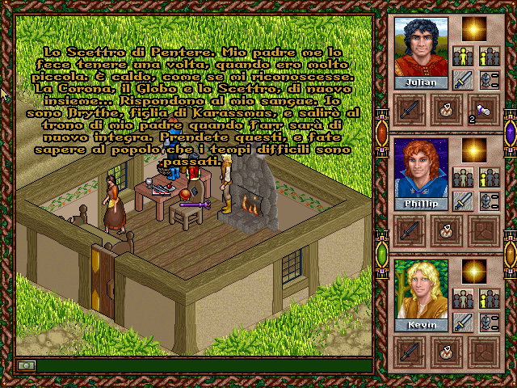
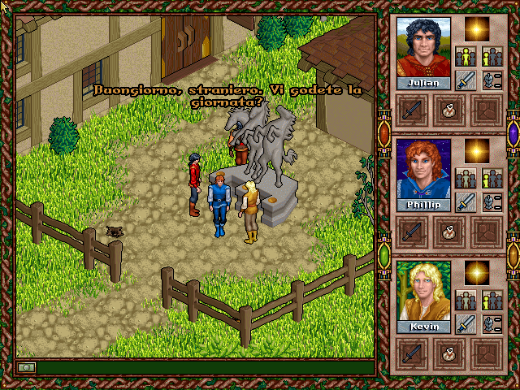
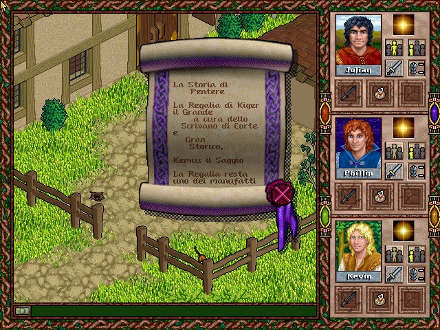
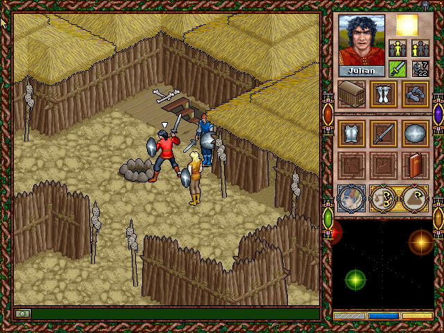
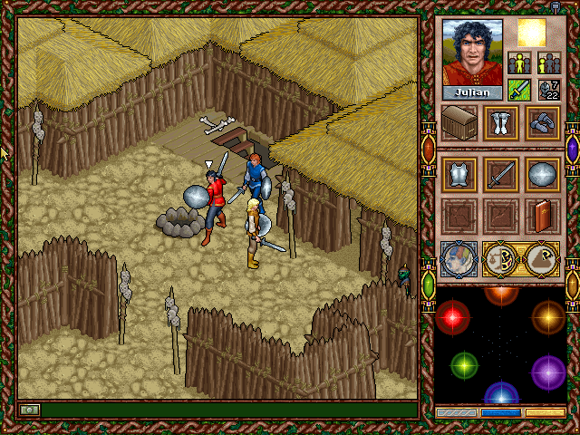
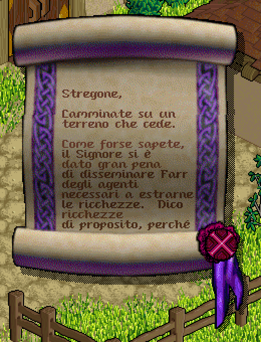

# Faery Tale Adventure II: Halls of the Dead — restauro italiano

Restauro non ufficiale della versione DOS di **Faery Tale Adventure II: Halls of the Dead**
(The Dreamers Guild, 1997):

- bug del gioco e del motore corretti;
- tre quest lasciate a metà completate, usando i contenuti rimasti nei dati;
- traduzione italiana completa di dialoghi, libri, nomi e interfaccia.

Il gioco gira su una versione modificata di [ScummVM](https://www.scummvm.org/), le cui patch sono
in questo repository.

> **Il gioco non è incluso.** Il repository e il pacchetto contengono solo il lavoro del
> restauro: motore, strumenti, patch e traduzione. Serve una copia originale della versione DOS.

*English summary: an unofficial restoration of the DOS version of Faery Tale Adventure II with
bug fixes, three unfinished quests completed from content left in the game data, and a complete
Italian translation. It runs on a patched ScummVM. You need your own copy of the original game.*



## Indice

- [Cosa cambia](#cosa-cambia)
- [Immagini](#immagini)
- [Installazione dal pacchetto](#installazione-dal-pacchetto)
- [Compilare dai sorgenti](#compilare-dai-sorgenti)
- [Come funziona](#come-funziona)
- [Collaudo](#collaudo)
- [Struttura del repository](#struttura-del-repository)
- [Documentazione del lavoro](#documentazione-del-lavoro)
- [Crediti e note legali](#crediti-e-note-legali)
- [Licenza](#licenza)

## Cosa cambia

### Bug corretti

| | Problema | Correzione |
|---|---|---|
| Motore | Il segmento dati degli script esisteva in due copie. Capitan Navis non portava a Tamnath anche con Muybridge morto, l'incantesimo Timequake non funzionava, e altri tre collegamenti fra script erano rotti | Una sola copia del segmento dati |
| Motore | Crash casuali nelle Sale dei Morti, quando i mostri lanciano incantesimi | Numeri di incantesimo convertiti correttamente |
| Motore | Con più di 255 di mana le stelle uscivano dall'indicatore (nel DOS: crash al clic sul ritratto) | Stelle limitate al bordo |
| Motore | Un forziere spostato spariva col suo contenuto | I contenitori pieni non vengono eliminati |
| Motore | I salvataggi fatti mentre più personaggi parlano non si caricavano | Lettura delle battute salvate corretta |
| Motore | I salvataggi del gioco DOS con un incantesimo in volo bloccavano il caricamento | Lettura del formato DOS |
| Dati | Rallo Jovanc, il fantasma bambino, poteva morire, e la ricompensa della sua quest era persa | Rallo immune ai danni |
| Script | Le battute cannibali di Krogatt non venivano mai usate | Ricollegate ai suoi attacchi speciali |

L'elenco completo, con le analisi e i casi verificati come comportamenti voluti, è in
[CATALOGO.md](CATALOGO.md).

### Quest completate

- **La Regalia di Pentere.**
  - **Cosa c'era già nel gioco:** i libri del palazzo raccontano la Corona, il Globo e lo Scettro
    che provano il vero erede. C'erano anche Brythe, la principessa creduta morta, e il proclama
    e il decreto della nuova regina, mai mostrati.
  - **Cosa è stato aggiunto:** Corona e Scettro si trovano negli inventari di Smash e di Bluto, e
    il Globo non si perde più se colpito. Brythe reagisce a ogni pezzo e, con la Regalia completa,
    consegna proclama, decreto e una ricompensa.
- **Il flauto e i topi di Padavis.** Suonare un flauto vicino alle tane di Padavis porta via i
  topi per sempre, e One-eyed Wort, il gestore del granaio, paga la ricompensa promessa.
- **Il cuore di Roska.** Finché Roska vive il cuore resiste ai colpi. Dopo la sua morte si spezza,
  e la terra di Karminac è liberata.

Le proposte e le scelte di progetto sono in [PROPOSTE_QUEST.md](PROPOSTE_QUEST.md).

### Traduzione italiana

- **7.317 testi tradotti:** dialoghi, libri, lettere e messaggi. **1.153 nomi** di oggetti, mostri
  e incantesimi, più l'interfaccia del motore.
- **Voci:** restano quelle inglesi originali, con i sottotitoli italiani.
- **Prezzi parlati:** i mercanti li componevano a pezzi in inglese. Ora il numero compare in
  cifre ("3420 sovrane"), mentre la voce lo pronuncia per intero.
- **Libri:** controllati con una simulazione dell'impaginazione del motore. I versi e le colonne
  strette stanno nella pagina come nell'originale.
- **Regole e glossario:** sono in [traduzione/GUIDA.md](traduzione/GUIDA.md).

## Immagini

| | |
|---|---|
|  |  |
| Dialogo: la voce è inglese, il sottotitolo italiano | La pergamena della Regalia, con il carattere originale |
|  |  |
| Mana oltre 200: prima le stelle uscivano o sparivano… | …ora restano sul bordo |

<p align="center"></p>
<p align="center"><em>La lettera di Lord Thebe a Roska: i versi tradotti stanno nella colonna</em></p>

## Installazione dal pacchetto

Il pacchetto per Linux a 64 bit è fra le [Release](https://github.com/Indr1d-C0ld/faery-tale-adventure-2-ita/releases):
`fta2-restauro-ita-VERSIONE-linux-x86_64.tar.gz`, con il suo `.sha256`.

**Requisiti:**
- le librerie SDL2, libpng e zlib, di solito già installate;
- Python 3;
- la versione DOS del gioco: `FTA2.EXE`, i sei file `.HRS` e la cartella `DRIVERS`.

```bash
tar xzf fta2-restauro-ita-1.0.0-linux-x86_64.tar.gz
cd fta2-restauro-ita-1.0.0-linux-x86_64
./installa.sh /percorso/della/cartella/FTA2
./gioca.sh
```

- **La copia originale non viene toccata:** l'installatore copia i file del gioco in `gioco/` e
  ricostruisce `FTA.HRS` e `SCRIPTS.HRS` con il restauro.
- **Partita nuova:** le quest nuove e le correzioni ai personaggi la richiedono, perché i
  salvataggi conservano oggetti e personaggi.

## Compilare dai sorgenti

**Requisiti** (Debian e Ubuntu: `build-essential git libsdl2-dev zlib1g-dev libfreetype-dev
libpng-dev python3`).

```bash
# 1. motore: scarica ScummVM 2026.4.0, applica motore/*.patch e compila il motore SAGA2
tools/compila_motore.sh

# 2. gioco: indica dove si trova la copia originale e costruisci gli archivi restaurati
FTA2_ORIGINALI=/percorso/FTA2 FTA2_USCITA=$PWD/gioco python3 -I tools/costruisci.py

# 3. pacchetto da distribuire (facoltativo)
tools/crea_pacchetto.sh 1.0.0

# 4. versione per MS-DOS su CD (facoltativo), per esempio per Retro486
FTA2_ORIGINALI=/percorso/FTA2 tools/crea_dos.sh
```

**La versione per MS-DOS.** `crea_dos.sh` prepara in `build/dos/` due parti:
- `FTA2/`, da copiare sul disco fisso (4 MB): l'eseguibile originale, i driver audio, gli archivi
  tradotti e un `FTA2.INI` che cerca il resto in `D:\FTA2`;
- `FTA2DATI.ISO`, un CD con immagini, suoni e voci (288 MB), scritto da `tools/crea_iso.py` senza
  strumenti esterni.

La traduzione e le correzioni negli script e nei dati valgono anche con l'eseguibile originale.
Le correzioni al motore, invece, ci sono solo con ScummVM. È provata su un 486 DX4-100 emulato
con 32 MB, VESA e lettore CD; l'audio è preimpostato per una Sound Blaster 16 a 220h.

`gioca.sh` avvia il gioco dalla cartella del progetto. Gli strumenti di analisi (disassemblatore,
estrattori, simulatore dell'impaginazione) sono descritti in [tools/README.md](tools/README.md).

## Come funziona

**Gli archivi.** FTA2 usa il motore SAGA2 della Dreamers Guild. I dati stanno in archivi HRES
(`.HRS`), e la logica di gioco in un bytecode compilato dentro `SCRIPTS.HRS`.

**Disassemblatore e assemblatore.** Il restauro ha scritto un disassemblatore e un assemblatore
per questo bytecode (`tools/sagadis.py`, `tools/sagaasm.py`). Sono verificati: riassemblano
identici tutti i 161 moduli originali.

**Le patch.** Nessun file del gioco è nel repository: tutto si ricostruisce dalla copia originale.
- **Script:** sono differenze (`patch/script/*.diff`) rispetto al listato disassemblato. Il codice
  nuovo va in coda ai moduli, così nessun indirizzo originale si sposta.
- **Dati:** sono tabelle (`patch/*.tsv`) di nomi, prototipi, oggetti e byte da cambiare.
- **Traduzione:** in `traduzione/testi_it.tsv` e `traduzione/nomi_it.tsv` c'è solo l'italiano.
  Al posto del testo inglese c'è un CRC32, che verifica che ogni riga si applichi alla stringa
  giusta.
- **Motore:** le patch a ScummVM (`motore/*.patch`) sono commit separati, uno per correzione, con
  la spiegazione nel messaggio.

## Collaudo

Il motore modificato contiene degli scenari di prova (`engines/saga2/collaudo.cpp`). Si attivano
solo con una chiave nella configurazione, quindi non toccano il gioco normale.

```bash
tools/collaudo.sh asan      # con AddressSanitizer (build in build-asan/)
tools/collaudo.sh normale
```

Gli scenari:
- **quest:** 22 controlli sulle quest e sulle correzioni, a partire da una partita nuova;
- **salvataggio:** 5 controlli su salvataggio e caricamento;
- **giri:** salti casuali nel mondo per migliaia di fotogrammi, sulla partita nuova e su 11
  salvataggi d'epoca, alla ricerca di crash ed errori di memoria.

Il rapporto si trova in `prove/collaudo/RAPPORTO.txt`.

## Struttura del repository

| Percorso | Contenuto |
|---|---|
| `tools/` | Strumenti in Python: archivi HRES, disassemblatore e assemblatore, costruttore, traduzione, analisi, impaginazione, collaudo, pacchetto |
| `patch/` | Patch degli script (differenze) e dei dati (tabelle) |
| `traduzione/` | Traduzione italiana (solo italiano, con CRC32), guida di stile e glossario |
| `motore/` | Patch a ScummVM 2026.4.0 (`git format-patch`) |
| `distribuzione/` | Installatore, lanciatore e LEGGIMI del pacchetto |
| `immagini/` | Schermate |
| `CATALOGO.md`, `PIANO.md`, `PROPOSTE_QUEST.md` | Documentazione del lavoro |

## Documentazione del lavoro

- [CATALOGO.md](CATALOGO.md): bug, contenuti tagliati e quest incomplete, con le prove e lo stato
  di ciascuno.
- [PIANO.md](PIANO.md): le fasi del progetto e i loro risultati.
- [PROPOSTE_QUEST.md](PROPOSTE_QUEST.md): le proposte di completamento, realizzate e no.
- [traduzione/GUIDA.md](traduzione/GUIDA.md): regole, registro, glossario e decisioni sui casi dubbi.
- [tools/README.md](tools/README.md): formati dei dati e uso degli strumenti.

Alcuni documenti citano cartelle di lavoro locali (`estratti/`, `prove/`, `build/`) che non sono
pubblicate, perché contengono dati del gioco: gli strumenti le ricreano dalla copia originale.

## Crediti e note legali

- **Faery Tale Adventure II: Halls of the Dead** è © The Wyrmkeep Entertainment Co. Il gioco fu
  sviluppato da The Dreamers Guild. Questo progetto non è affiliato né approvato dai titolari dei
  diritti, e non distribuisce file del gioco.
- **[ScummVM](https://www.scummvm.org/)** e il suo motore SAGA2, basato sui sorgenti originali
  del gioco, sono opera del ScummVM Team (GPL3).
- Le soluzioni d'epoca e le segnalazioni dei giocatori sono state la base della ricerca sui bug e
  sulle quest. Sono citate nel catalogo.

## Licenza

Il codice, le patch e la traduzione di questo repository sono distribuiti con licenza
**GNU General Public License versione 3**: vedi [LICENSE](LICENSE). Le patch a ScummVM restano
sotto la licenza di ScummVM (GPL versione 3 o successiva).
